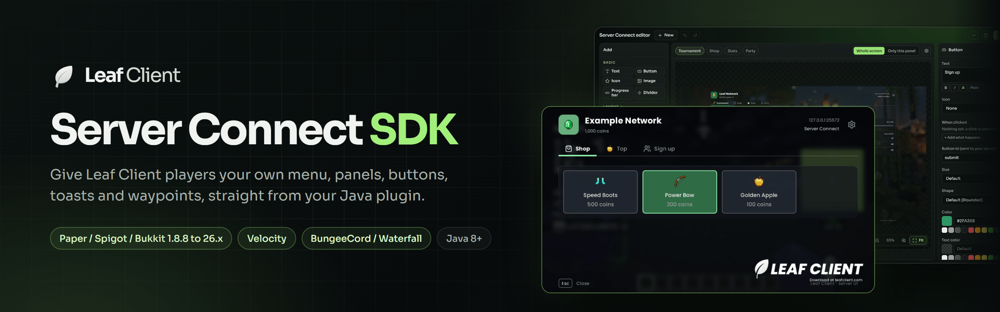
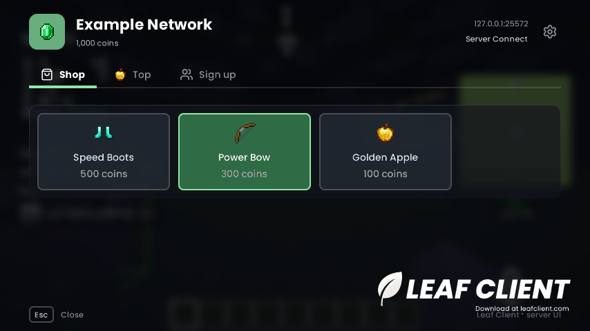
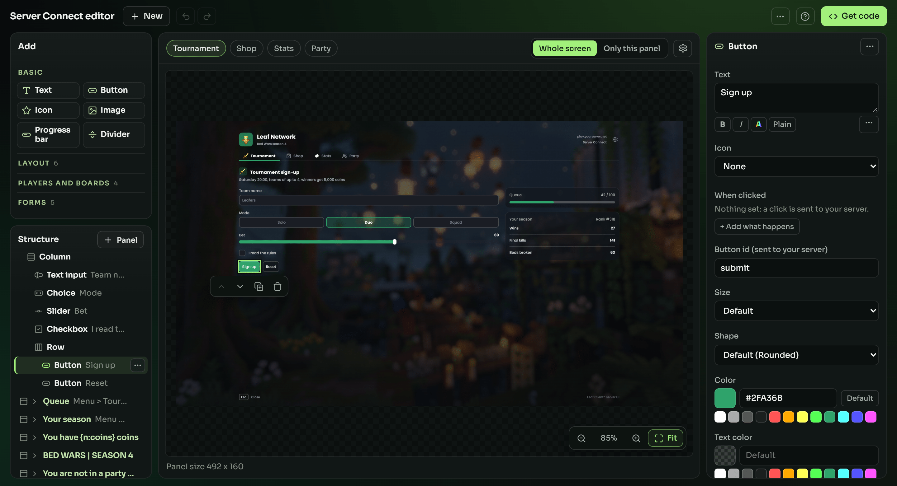
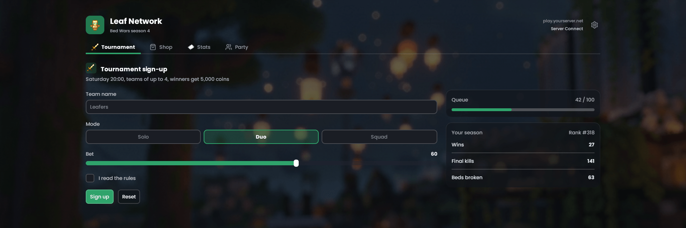
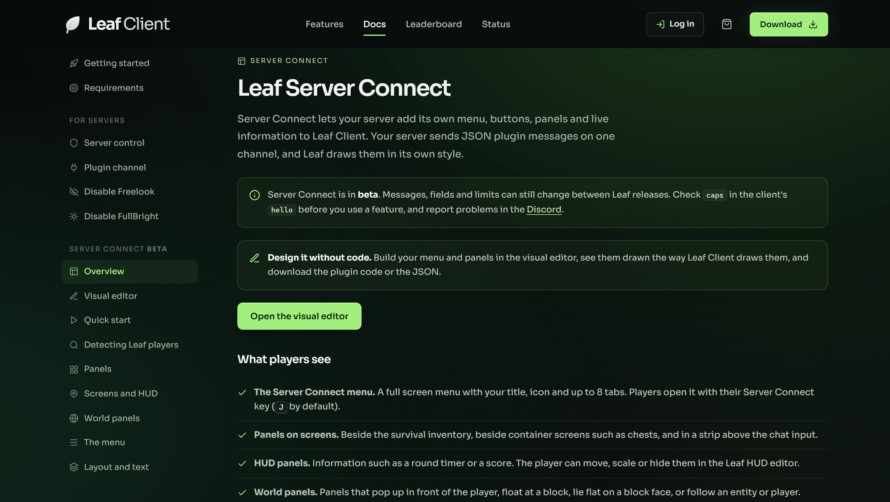
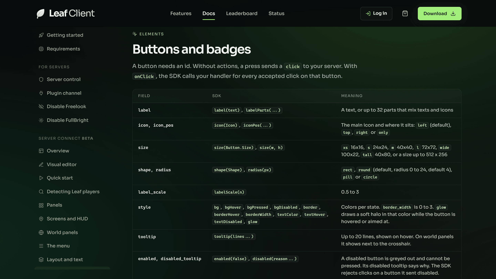

<p align="center">
  <a href="https://leafclient.com/docs/#server-connect">
    
  </a>
</p>

<p align="center">
  <a href="LICENSE"></a>
  <a href="https://github.com/LeafClientMC/ServerConnectSDK/releases/tag/v0.2.0"></a>
  <a href="https://jitpack.io/#LeafClientMC/ServerConnectSDK"></a>
  
  <br>
  
  
  
  <a href="https://discord.gg/wvYqKpUNdb"></a>
</p>

<p align="center">
  <a href="https://leafclient.com/docs/#server-connect"><b>Documentation</b></a>
  &nbsp;&middot;&nbsp;
  <a href="https://leafclient.com/docs/editor/"><b>Visual editor</b></a>
  &nbsp;&middot;&nbsp;
  <a href="#quick-start"><b>Quick start</b></a>
  &nbsp;&middot;&nbsp;
  <a href="example/src/main/java/com/leafclient/connect/example/ExamplePlugin.java"><b>Example plugin</b></a>
  &nbsp;&middot;&nbsp;
  <a href="https://discord.gg/wvYqKpUNdb"><b>Discord</b></a>
</p>

## What is Server Connect

Server Connect lets your Minecraft server add its own menu, buttons, panels and live information to [Leaf Client](https://leafclient.com). Your server sends JSON plugin messages on one channel, `leafclient:connect`, and Leaf Client draws them in its own style. Players who do not use Leaf see nothing and send nothing.

This SDK is the Java side. It builds the JSON for you, checks it against the client limits before anything is sent, batches it, and checks every click that comes back before your handler runs.

<p align="center">
  
  <br>
  <sub>The shop tab of the <a href="example/src/main/java/com/leafclient/connect/example/ExamplePlugin.java">example plugin</a>, in game.</sub>
</p>

> [!NOTE]
> Server Connect is in beta. Messages, fields and limits can still change between Leaf releases. Check the client's caps before you use a feature, and report problems in the [Discord](https://discord.gg/wvYqKpUNdb).

## Features

- **Server menu.** A full screen menu with your title, icon and up to 8 tabs. Players open it with their Server Connect key (J by default).
- **Panels in 8 places.** Menu tabs, beside the inventory, beside container screens such as chests, above the chat, on the HUD, in front of the player, at a block, and on an entity or player.
- **Elements.** Text, buttons, badges, icons, images from a resource pack or an https link, 3D player models, player heads, lists, progress bars, leaderboards, scroll areas, and rows, columns, grids and layers.
- **Forms.** Text fields, toggles, checkboxes, choices and sliders. Their values arrive with the click, already checked against the panel you sent.
- **Button actions.** Send the click to your server, run a command, open a link, copy text, suggest a chat message, open the menu or a panel, close, or set a waypoint. Commands, links and copied text always ask the player first.
- **Live values and timers.** `{v:key}`, `{n:key}` and `{t:key}` placeholders change shown text without sending the UI again. Conditions show, hide or enable elements on the client with no round trip.
- **Updates in place.** `Patch` changes fields of a panel the player already has.
- **Toasts and waypoints.** Leaf notifications with up to 2 buttons, and server waypoints.
- **Mod locks.** `Session.lockMods` turns off chosen client mods on your server and shows the player why.
- **Checked before sending.** A value that breaks a client limit throws `InvalidUiException` with the field path, so the client never receives UI it would reject.
- **Checked clicks.** Your handler runs only for clicks that pass the SDK checks: known panel, matching token, enabled button, cooldown, valid inputs and, on Paper, reach for world panels.
- **Batching.** Messages queued in the same tick go out in one frame, large messages are split into chunks, and sending stays within the client rate limits. Sessions are thread safe.
- **Old and new servers.** The core and paper modules target Java 8 and run with the Gson 2.2.4 that Spigot 1.8.8 ships. On Folia, each player's messages are sent from that player's own region thread. Behind a proxy, `onReady` runs again after every backend switch.

## Visual editor

Build menus and panels without code in the [Server Connect editor](https://leafclient.com/docs/editor/). The preview runs Leaf Client's own layout engine in the browser, so panels are laid out the way the game lays them out. When the design is ready, press **Get code** and download the plugin code for Paper / Spigot, Velocity or BungeeCord, or copy the raw JSON.

<p align="center">
  
  <br>
  <sub>Editing a menu tab. The structure is on the left, the selected button's properties on the right.</sub>
</p>

<p align="center">
  
  <br>
  <sub>The same tab in the editor's whole screen preview.</sub>
</p>

## Documentation

The full guide is on the Leaf website: <https://leafclient.com/docs/#server-connect>. Every example there shows the SDK code and the raw JSON it sends.

<p align="center">
  
  &nbsp;
  
</p>

| Start here | Build UI | Reference |
| --- | --- | --- |
| [Quick start](https://leafclient.com/docs/#sc-quickstart) | [Panels](https://leafclient.com/docs/#sc-panels) | [Message reference](https://leafclient.com/docs/#sc-reference) |
| [Detecting Leaf players](https://leafclient.com/docs/#sc-detect) | [Screens and HUD](https://leafclient.com/docs/#sc-placements) | [Limits](https://leafclient.com/docs/#sc-limits) |
| [Platform guides](https://leafclient.com/docs/#sc-platforms) | [World panels](https://leafclient.com/docs/#sc-world) | [Validating clicks](https://leafclient.com/docs/#sc-validate) |
| [Recipes](https://leafclient.com/docs/#sc-recipes) | [Buttons and badges](https://leafclient.com/docs/#sc-buttons) | [Batching on a real server](https://leafclient.com/docs/#sc-batching) |
| [Troubleshooting](https://leafclient.com/docs/#sc-troubleshooting) | [Live values and timers](https://leafclient.com/docs/#sc-values) | [Bans and the block list](https://leafclient.com/docs/#sc-blocklist) |

## Quick start

### Modules

| Module | Package | For | Java |
| --- | --- | --- | --- |
| `core` | `com.leafclient.connect.sdk` | Builders, sessions, batching and click checks | 8+ |
| `paper` | `com.leafclient.connect.sdk.paper` | Paper (also Spigot, Bukkit, Purpur and Folia), 1.8.8 to 26.x | 8+ |
| `velocity` | `com.leafclient.connect.sdk.velocity` | Velocity proxies | 17+ |
| `bungee` | `com.leafclient.connect.sdk.bungee` | BungeeCord and Waterfall proxies | 8+ |

Each platform module includes `core`. Shade the one you need into your plugin jar. The SDK uses the Gson library your server already ships, and registers the `leafclient:connect` channel in code, so `plugin.yml` needs no channels entry.

### Install

The SDK is on [JitPack](https://jitpack.io/#LeafClientMC/ServerConnectSDK). The examples add `paper`. For a proxy plugin, use `velocity` or `bungee` instead.

> [!NOTE]
> 0.2.0 renames the `bukkit` module to `paper`. When you update from 0.1.x, change the artifact from `bukkit` to `paper`, the import from `com.leafclient.connect.sdk.bukkit.BukkitConnect` to `com.leafclient.connect.sdk.paper.PaperConnect`, and `BukkitConnect` to `PaperConnect` in your code. The module still runs on Spigot and Bukkit, and now on Folia too.

**Gradle** (`build.gradle.kts`), then build with `./gradlew shadowJar`:

```kotlin
plugins {
    java
    id("com.gradleup.shadow") version "8.3.5"
}

repositories {
    mavenCentral()
    maven("https://jitpack.io")
}

dependencies {
    implementation("com.github.LeafClientMC.ServerConnectSDK:paper:v0.2.0")
}
```

**Maven** (`pom.xml`), then build with `mvn package`:

```xml
<repositories>
    <repository>
        <id>jitpack.io</id>
        <url>https://jitpack.io</url>
    </repository>
</repositories>

<dependencies>
    <dependency>
        <groupId>com.github.LeafClientMC.ServerConnectSDK</groupId>
        <artifactId>paper</artifactId>
        <version>v0.2.0</version>
    </dependency>
</dependencies>

<build>
    <plugins>
        <plugin>
            <groupId>org.apache.maven.plugins</groupId>
            <artifactId>maven-shade-plugin</artifactId>
            <version>3.6.0</version>
            <executions>
                <execution>
                    <phase>package</phase>
                    <goals><goal>shade</goal></goals>
                </execution>
            </executions>
        </plugin>
    </plugins>
</build>
```

### Paper (also Spigot, Bukkit, Folia)

```java
package com.example.shop;

import com.leafclient.connect.sdk.Condition;
import com.leafclient.connect.sdk.Icon;
import com.leafclient.connect.sdk.Menu;
import com.leafclient.connect.sdk.Panel;
import com.leafclient.connect.sdk.Place;
import com.leafclient.connect.sdk.Session;
import com.leafclient.connect.sdk.Toast;
import com.leafclient.connect.sdk.Ui;
import com.leafclient.connect.sdk.paper.PaperConnect;
import org.bukkit.plugin.java.JavaPlugin;

public final class ShopPlugin extends JavaPlugin {
    private PaperConnect connect;

    @Override
    public void onEnable() {
        connect = PaperConnect.enable(this);
        connect.onReady(this::sendUi);
    }

    @Override
    public void onDisable() {
        connect.disable();
    }

    private void sendUi(Session s) {
        s.send(Menu.create("Example Network")
                .subtitle("{n:coins} coins")
                .icon(Icon.item("minecraft:emerald"))
                .add(Menu.tab("shop", "Shop").icon(Icon.leaf("shop"))));
        s.setValue("coins", 1000);
        s.send(Panel.create("shop", Place.menu("shop")).content(
                Ui.text("&lWelcome!"),
                Ui.button("boots", "Speed Boots")
                        .icon(Icon.item("minecraft:diamond_boots"))
                        .enabledWhen(Condition.ge("coins", 500))
                        .onClick(click -> click.session().send(
                                Toast.create("bought").title("Bought Speed Boots").kind(Toast.Kind.SUCCESS)))));
    }
}
```

`onReady` runs when a Leaf client says hello. Everything sent in the same tick goes out in one batch. On Paper, Spigot and Bukkit, listeners and click handlers run on the main server thread, so you can call the Bukkit API in them.

**Folia.** Add `folia-supported: true` to your `plugin.yml`. `PaperConnect` detects Folia by itself and sends each player's messages from that player's own region thread, so the SDK calls stay the same. Listeners and click handlers run on the region thread of the player who sent the message. Use Folia's schedulers before you change blocks, entities or players in other regions, and keep shared plugin data in thread safe collections.

### Velocity

```java
package com.example.network;

import com.google.inject.Inject;
import com.leafclient.connect.sdk.Action;
import com.leafclient.connect.sdk.Panel;
import com.leafclient.connect.sdk.Place;
import com.leafclient.connect.sdk.Ui;
import com.leafclient.connect.sdk.velocity.VelocityConnect;
import com.velocitypowered.api.event.Subscribe;
import com.velocitypowered.api.event.proxy.ProxyInitializeEvent;
import com.velocitypowered.api.event.proxy.ProxyShutdownEvent;
import com.velocitypowered.api.plugin.Plugin;
import com.velocitypowered.api.proxy.ProxyServer;
import org.slf4j.Logger;

@Plugin(id = "networkbar", name = "NetworkBar", version = "1.0.0")
public final class NetworkBar {
    private final ProxyServer proxy;
    private final Logger logger;
    private VelocityConnect connect;

    @Inject
    public NetworkBar(ProxyServer proxy, Logger logger) {
        this.proxy = proxy;
        this.logger = logger;
    }

    @Subscribe
    public void onInit(ProxyInitializeEvent event) {
        connect = VelocityConnect.enable(this, proxy, logger);
        connect.onReady(s -> s.send(Panel.create("net.bar", Place.chat().order(-1))
                .scope(Panel.Scope.CONNECTION)
                .content(Ui.row(
                        Ui.button("net.lobby", "Lobby").on(Action.command("/server lobby")),
                        Ui.button("net.bedwars", "Bed Wars").on(Action.command("/server bedwars"))))));
    }

    @Subscribe
    public void onShutdown(ProxyShutdownEvent event) {
        connect.disable();
    }
}
```

`Panel.Scope.CONNECTION` keeps the bar when the player switches backend servers.

### BungeeCord and Waterfall

```java
package com.example.network;

import com.leafclient.connect.sdk.Action;
import com.leafclient.connect.sdk.Panel;
import com.leafclient.connect.sdk.Place;
import com.leafclient.connect.sdk.Ui;
import com.leafclient.connect.sdk.bungee.BungeeConnect;
import net.md_5.bungee.api.plugin.Plugin;

public final class NetworkBar extends Plugin {
    private BungeeConnect connect;

    @Override
    public void onEnable() {
        connect = BungeeConnect.enable(this);
        connect.onReady(s -> s.send(Panel.create("net.bar", Place.chat().order(-1))
                .scope(Panel.Scope.CONNECTION)
                .content(Ui.row(
                        Ui.button("net.lobby", "Lobby").on(Action.command("/server lobby")),
                        Ui.button("net.bedwars", "Bed Wars").on(Action.command("/server bedwars"))))));
    }

    @Override
    public void onDisable() {
        connect.disable();
    }
}
```

On both proxies, buttons whose only actions are commands send no click to the server. Add `Action.send()` to their actions if your plugin needs the click. See the [platform guides](https://leafclient.com/docs/#sc-platforms) for running a proxy and backends together.

### Example plugin

[`example/`](example) is a complete Paper plugin that also runs on Folia, Spigot and Bukkit: a menu with a shop, a leaderboard and a sign up form, a coins value, and a panel at the world spawn. It is the plugin in the in-game screenshot above.

## License

[MIT](LICENSE)
